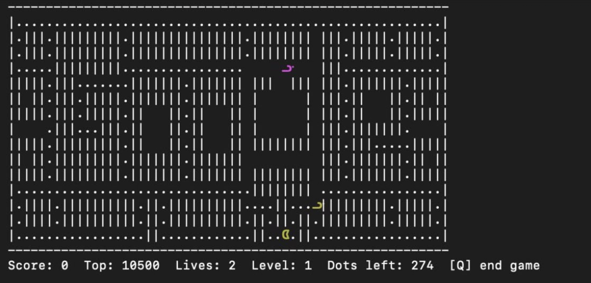

# Pac-Man in x86-64 Assembly

A complete, playable Pac-Man game for the terminal, written in x86-64 assembly (AT&T syntax, GNU assembler) for Linux. The whole game lives in a single file, `pacman.s`.

Eat all the dots, dodge the two ghosts, and survive as many rounds as you can. Every round the ghosts get faster, and the game only ends when you run out of lives or quit.

## Screenshot



## Features

- Real-time play in the terminal with instant key presses (no Enter needed)
- Coloured Pac-Man and ghosts drawn with Unicode characters (`ᗧ` and `ᗣ`)
- Two ghosts with different behaviour: a greedy chaser and a random wanderer
- Endless rounds: clearing the maze starts a new round with faster ghosts
- Lives, score, level and dots-left display
- Persistent top-5 high scores, saved to a file and viewable from the menu
- Start menu with play, high scores and quit

## Requirements

- Linux on x86-64 (the program uses Linux system calls directly)
- `gcc` (used to assemble and link, and to provide the C library)
- A terminal that supports ANSI colours and UTF-8, with a font that includes the characters `ᗧ` and `ᗣ`

macOS and Windows are not supported natively. On those systems, run the game inside a Linux x86-64 environment such as a VM or a Docker container started with `--platform linux/amd64` and an interactive terminal (`-it`).

## Build and run

```
gcc -no-pie -o pacman pacman.s
./pacman
```

The `-no-pie` flag is required. Run the game from an interactive terminal, not from an editor's output panel.

## How to play

### Menu

| Key | Action |
|-----|--------|
| `P` | Play |
| `H` | Show the high scores |
| `Q` | Quit |

### In the game

| Key | Action |
|-----|--------|
| `W` | Move up |
| `A` | Move left |
| `S` | Move down |
| `D` | Move right |
| `Q` or `Ctrl-C` | End the current game and go back to the menu |

Press a direction slightly before a junction and Pac-Man will take the turn as soon as the way opens.

### Rules

- You start with 3 lives. Each dot is worth 10 points.
- Touching a ghost costs a life. Pac-Man and the ghosts then return to their start positions, and the dots you ate stay eaten.
- The magenta ghost chases you by always taking the step that gets it closest to you (Manhattan distance). The yellow ghost picks its direction at random. Both leave the ghost house after a short delay and cannot walk back in. Neither turns straight around unless it is in a dead end.
- Eating the last dot starts the next round: the maze is refilled and the ghosts speed up. Your score and remaining lives carry over.
- Ghost speed starts at 60% of Pac-Man's speed and rises by 10 percentage points per round, up to 150% (faster than Pac-Man) at round 10.
- The game ends when you lose your last life or press `Q`.

## High scores

The top 5 scores are stored in a binary file called `pacman_scores.dat` (five 8-byte numbers) in the folder you run the game from. The game creates it automatically the first time a score makes the table, loads it at start-up, and updates it after every game. Delete the file to reset the scores.

The file is runtime data and should not be committed. Add it to your `.gitignore`:

```
pacman_scores.dat
```

## Project structure

```
pacman.s    the whole game
```

Inside `pacman.s`, from top to bottom:

1. Constants (`.equ`): maze size, keys, game settings, ghost record layout, system call numbers
2. `.data`: the pristine maze, game state, ghost table, sprites and strings
3. `.bss`: the working maze, score table, terminal settings and the frame buffer
4. `.text`: the subroutines

| Subroutine | Purpose |
|------------|---------|
| `main`, `play_game`, `wait_key` | Menu, game loop, waiting for a key |
| `term_raw`, `term_restore` | Switch the terminal to instant, non-echoing input and back |
| `new_game`, `load_maze`, `next_round` | Set up a game or a new round |
| `input_poll`, `update` | Read keys, move Pac-Man, eat dots |
| `ghosts_update`, `ghost_move`, `ghost_can_enter` | Ghost speed, movement and the ghost-house door |
| `check_collision`, `lose_life`, `reset_positions` | Collisions and respawning |
| `render`, `sprite_at`, `emit_str` | Build and print each frame |
| `load_scores`, `save_scores`, `add_score`, `show_scores` | High score table and file |
| `next_random`, `cell_addr`, `is_open`, `sleep_tick` | Helpers |

### How it works in short

- **Game loop:** every tick (about 120 ms) the game reads input, updates the world, draws a frame and sleeps. The loop is input, update, render, sleep.
- **Input:** the terminal is switched to raw mode with `ioctl`, and `read` returns immediately when no key is pressed, so the game keeps running.
- **Drawing:** each frame is built in a memory buffer and written to the terminal with a single `write` call, using ANSI escape codes for cursor movement and colour.
- **Ghost speed:** each tick adds the ghost speed to an accumulator, and the ghosts take one step every time it reaches 100.
- **Scores:** a small insertion into a sorted table of five entries, saved with the `open`, `write` and `close` system calls.
- **Calling conventions:** the code follows the System V x86-64 conventions (arguments in `rdi`, `rsi`, `rdx`, `rcx`, `r8`, `r9`, callee-saved registers preserved, stack kept 16-byte aligned for `printf` and `snprintf`).

## Configuration

Gameplay can be tuned with the constants at the top of `pacman.s`:

| Constant | Meaning | Default |
|----------|---------|---------|
| `START_LIVES` | Lives at the start of a game | 3 |
| `DOT_SCORE` | Points per dot | 10 |
| `TICK_NSEC` | Length of one tick in nanoseconds (smaller is faster) | 120000000 |
| `GHOST_SPEED_START` | Ghost speed in round 1, in percent of Pac-Man's speed | 60 |
| `GHOST_SPEED_STEP` | Speed increase per round | 10 |
| `GHOST_SPEED_MAX` | Maximum ghost speed | 150 |
| `SCORE_COUNT` | Number of saved high scores (delete the old `.dat` file if you change this) | 5 |

To change the look, edit the sprite strings (`player_str`, `ghost_magenta`, `ghost_yellow`). Each is a colour code, the UTF-8 bytes of the character (written as octal escapes) and a colour reset.

To change the maze, edit the rows of `maze_orig`. Every row must be exactly 58 characters, the maze must be enclosed by walls, and it must contain exactly one `P` (Pac-Man's start). The ghost house position (`EXIT_X`, `EXIT_Y`, `DOOR_Y`, `DOOR_X0`, `DOOR_X1`) and the ghost start positions are fixed numbers and must be updated if the house moves.

## Troubleshooting

- **The terminal looks broken after a crash:** the game switches the terminal to raw mode and restores it on a normal exit. If it was killed, type `reset` and press Enter.
- **Pac-Man or the ghosts show as empty boxes:** your terminal font lacks those characters. Switch to a font that has them, or replace the bytes in the sprite strings with plain letters.
- **`ld: unknown file type` or `as: unknown argument` on a Mac:** the game is Linux-only. Build and run it in a Linux x86-64 environment.
- **Crash right after start with a segmentation fault:** make sure you built with `-no-pie` and that you are running it in a terminal.
